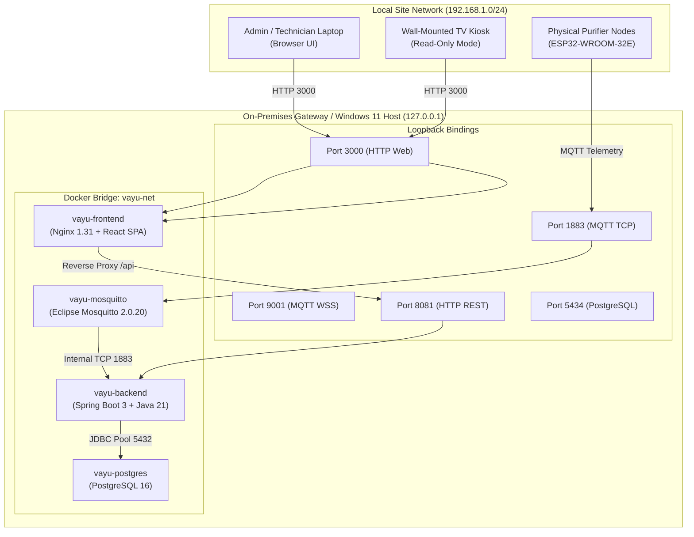

# SOCHI VAYU — Industrial Air Quality Monitoring & Autonomous Control Platform
# Master Architecture, Technical Specification & Operations Reference Manual

**Document Version:** 1.0.0  
**Target Audience:** Software Engineers, Embedded Firmware Developers, Site Technicians, DevOps & System Administrators  
**Project Workspace:** `D:\SochiProjects\VAYU\VayuMonitoringDashboard`  
**Brand Identity:** SOCHI Navy (`#0B1F3A`), Accent Orange (`#F47721`), White (`#FFFFFF`), Pale Grey (`#F8F9FA`)

---

## 1. Executive Summary & Purpose

The **SOCHI VAYU** platform is an industrial-grade, local-first IoT air quality monitoring and control system. It is designed to monitor and manage fleets of commercial air purifiers across corporate headquarters, cleanrooms, research labs, and manufacturing sites without relying on external cloud dependencies.

### Core Architectural Mandates (Non-Negotiable)
1. **Zero External Cloud Hosting:** All core services (MQTT broker, database, API gateway, monitoring dashboards) run locally on edge gateways or on-premise hardware bound strictly to loopback (`127.0.0.1`).
2. **Autonomous Physical Safety:** Purifier safety behaviors (fan blower PID regulation, stall detection, thermal cutoffs) execute autonomously on the physical ESP32 microcontroller inside FreeRTOS tasks. Safety behavior **never** depends on network availability, the MQTT broker, or the backend server.
3. **Data Integrity & Traceability:** Simulated data is strictly labeled with `"is_simulated": true`. Physical hardware emits `"is_simulated": false`. Sensor fault conditions emit literal JSON `null` values; fabricated sensor numbers are strictly prohibited.
4. **Dual-Partition Safe OTA Rollouts:** Firmware updates require cryptographic SHA-256 validation, canary device trials, automated health checks, and bootloader rollback capability before fleet rollout.
5. **Consent-Governed Ephemeral Remote Troubleshooting:** Outbound-only ephemeral reverse tunnels replace open inbound VPN ports. Sessions require explicit customer administrator consent, enforce time-to-live (15–60 min), and provide an immediate Emergency Killswitch.

---

## 2. Technology Stack & Component Justifications

| Layer | Technology | Version | Justification & Role |
|---|---|---|---|
| **Microcontroller Firmware** | ESP-IDF / FreeRTOS (C11) | ESP-IDF v5.x | Deterministic real-time safety loop, hardware timer PWM fan control, optical tachometer pulse counting, dual-partition OTA table (`ota_0`, `ota_1`), and offline ring buffer (200 records). |
| **Message Broker** | Eclipse Mosquitto | 2.0.20 | Ultra-lightweight, high-throughput MQTT 3.1.1/5.0 broker. Implements username/password authentication, per-site Access Control Lists (ACLs), and WebSocket support on port `9001`. |
| **Backend Application** | Java / Spring Boot | Java 21 LTS / Spring Boot 3.3.4 | Enterprise-grade ingestion pipeline, Eclipse Paho MQTT client, JPA/Hibernate persistence, JWT authentication, RBAC authorization, automated diagnostic rule engine, and OTA canary orchestrator. |
| **Relational Database** | PostgreSQL | 16-alpine | High-reliability ACID persistence for telemetry history, device metadata, diagnostic incidents, and cryptographic action audit trails. Runs on local port `5434`. |
| **Frontend Dashboard** | React / TypeScript / Vite | React 18, Vite 5.4 | Responsive, zero-cloud single-page application. Features custom SVG timeseries sparklines, real-time status badges, dedicated TV/Kiosk view mode, incident triage drawer, and remote consent console. |
| **Fleet Simulation** | Python 3 | 3.11+ | Multi-threaded 30-device fleet simulator. Models realistic PM2.5/PM10 Gaussian drift, volatile organic compound (VOC) spikes, Wi-Fi packet drops, tachometer stalls, and thermal fault states. |
| **Containerization** | Docker & Docker Compose | Docker Compose v2 | Isolated multi-container deployment guaranteeing 100% reproducible environments and strict loopback binding. |

---

## 3. System Architecture & End-to-End Data Flow

### 3.1 Network Topology & Isolation

All server containers reside within an internal Docker bridge network (`vayu-net`) and expose ports **only** to the host loopback adapter (`127.0.0.1`):



### 3.2 Telemetry Ingestion Flow
1. **Sensors** measure PM2.5, PM10, VOC index, temperature, and relative humidity.
2. The **ESP32 Core** computes the US-EPA AQI locally and executes the closed-loop blower control curve.
3. Every 3 seconds, a JSON telemetry payload conforming to **Contract v1.0.0** is published to `vayu/{device_id}/telemetry`.
4. If Wi-Fi is lost, the ESP32 pushes frames into its internal 200-sample bounded ring buffer. When Wi-Fi recovers, it replays the buffered records in strict chronological order.
5. The **Spring Boot Backend** (`MqttInboundConfig.java`) receives the payload, validates schema constraints, updates the in-memory cache, and asynchronously writes to PostgreSQL (`vayu_telemetry` table).
6. The **Diagnostic Engine** (`DiagnosticRuleEngine.java`) inspects the record against diagnostic thresholds (e.g., fan stall, sensor disconnect, filter saturation) and raises/resolves incidents automatically.
7. The **React Dashboard** polls every 3.5 seconds via `/api/devices`, `/api/incidents`, and `/api/remote-sessions` to present live SVG charts and alert badges.

---

## 4. MQTT Message Contract (v1.0.0)

### Telemetry Topic: `vayu/{device_id}/telemetry`
```json
{
  "schema_version": "1.0.0",
  "device_id": "VAYU-DEV-001",
  "timestamp": "2026-10-23T04:45:00.123Z",
  "is_simulated": false,
  "metrics": {
    "pm1": 4.2,
    "pm25": 11.8,
    "pm10": 18.5,
    "voc_index": 85,
    "temperature_c": 23.4,
    "humidity_rh": 48.2,
    "aqi": 49,
    "aqi_standard": "US-EPA"
  },
  "actuators": {
    "fan_speed_pct": 35,
    "tachometer_rpm": 1240,
    "mode": "AUTO"
  },
  "system": {
    "filter_hours_left": 2140,
    "wifi_rssi_dbm": -58,
    "firmware_version": "v1.1.0-rc1",
    "uptime_seconds": 86420,
    "error_code": 0
  },
  "diagnostics": {
    "pm_sensor_valid": true,
    "temp_sensor_valid": true,
    "fan_stall_detected": false,
    "thermal_warning": false
  }
}
```

### Status & LWT Topic: `vayu/{device_id}/status`
* **MQTT Last Will & Testament (LWT):** When a device drops ungracefully, the broker automatically publishes:
  ```json
  { "device_id": "VAYU-DEV-001", "status": "OFFLINE", "timestamp": "...", "reason": "UNEXPECTED_DISCONNECT" }
  ```
* **Graceful Connect:** Published on boot:
  ```json
  { "device_id": "VAYU-DEV-001", "status": "ONLINE", "timestamp": "...", "firmware_version": "v1.1.0-rc1" }
  ```

### Command Topic: `vayu/{device_id}/cmd`
Commands require backend authorization and are dispatched as:
```json
{
  "command_id": "CMD-9812-3412",
  "target_device": "VAYU-DEV-001",
  "action": "SET_FAN_SPEED",
  "params": { "speed_pct": 75 },
  "dispatched_by": "tech_pune",
  "timestamp": "2026-10-23T04:46:12Z"
}
```

---

## 5. Security Model & Role-Based Access Control (RBAC)

### 5.1 Personas & Permissions Matrix

| Persona | Default Username | Default Password | Site Scope | Allowed Capabilities |
|---|---|---|---|---|
| **Administrator** | `admin` | `SochiAdmin2026!` | `*` (All Sites) | Full fleet control, OTA release approval, Remote Support consent approval & killswitch, audit trail inspection. |
| **Field Technician** | `tech_pune` | `TechPune2026!` | `SITE-HQ-PUNE` | Scoped strictly to Pune devices; acknowledge/resolve incidents, adjust fan speeds, trigger filter resets. Bengaluru commands return HTTP 403. |
| **R&D Engineer** | `dev_eng` | `DevEng2026!` | `*` (All Sites) | Diagnostic metric analysis, raw sensor register inspection, request remote troubleshooting sessions, initiate canary OTA builds. |
| **TV / Kiosk** | `kiosk` | `KioskView2026!` | `*` (Read-Only) | Wall-mounted display mode. Actuator commands and incident mutations are strictly blocked (HTTP 403). |

### 5.2 Ephemeral Remote Troubleshooting Architecture (Phase 10)
Rather than opening permanent inbound firewall ports or running third-party remote desktop software:
1. **Request:** An R&D Engineer submits a request specifying the site, reason, and duration (15–60 min).
2. **Explicit Consent:** A Customer Administrator must log in to the dashboard and grant consent.
3. **Ephemeral Token:** The system generates a single-use token (`vayu_rst_<random64>`) with an active countdown timer.
4. **Outbound Reverse Tunnel:** The on-premise gateway initiates an outbound WSS connection to the authorized engineer.
5. **Emergency Killswitch:** The administrator can terminate the session at any second, which immediately closes the socket and wipes the session token from memory and database.

---

## 6. Complete Directory Structure

```
D:\SochiProjects\VAYU\VayuMonitoringDashboard\
├── docker-compose.yml              # Local multi-container orchestration
├── .env                            # Environment variables and secrets
├── backend\                        # Spring Boot 3 Java 21 REST API & Ingestion Gateway
│   ├── pom.xml                     # Maven project specification
│   ├── src\main\java\com\sochi\vayu\
│   │   ├── config\                 # SecurityConfig, MqttInboundConfig, JwtUtils
│   │   ├── controller\             # REST endpoints (Devices, Telemetry, Incidents, OTA, Remote)
│   │   ├── domain\                 # JPA Entities (Device, Telemetry, Incident, AuditLog, etc.)
│   │   ├── dto\                    # Request and response transfer objects
│   │   ├── repository\             # Spring Data JPA repositories
│   │   └── service\                # Ingestion, Diagnostics, RBAC, OTA, RemoteSession services
│   └── src\test\                   # JUnit 5 & Mockito test suites
├── frontend\                       # React 18 + TypeScript SPA
│   ├── package.json                # NPM dependencies (Vite, TypeScript, React)
│   ├── vite.config.ts              # Vite configuration with /api reverse proxy
│   ├── src\
│   │   ├── components\             # KpiCards, DeviceTable, TvKioskView, Modals (Incident, OTA, Remote)
│   │   ├── services\api.ts         # REST API client with JWT header injection
│   │   └── types\                  # TypeScript interface contracts
├── firmware\                       # Physical ESP32 Embedded Stack (ESP-IDF / FreeRTOS)
│   ├── esp32-vayu-node\
│   │   ├── partitions_two_ota.csv  # Dual OTA partition table (nvs, otadata, phy, ota_0, ota_1)
│   │   ├── main\
│   │   │   ├── safety_controller.c # FreeRTOS autonomous safety controller (PID, stalls, thermals)
│   │   │   ├── telemetry_buffer.c  # Bounded offline ring buffer (200 records FIFO)
│   │   │   └── ota_manager.c       # Bootloader rollback & partition verification
│   └── scripts\run_unit_tests.py   # GCC containerized firmware unit test runner
├── simulator\                      # 30-Device Multi-Condition Fleet Simulator
│   ├── fleet_simulator.py          # Master simulator orchestrator
│   ├── device_agent.py             # Single purifier physics engine & state machine
│   └── sim_config.json             # Device profiles, initial values & fault parameters
├── postgres\init\                  # PostgreSQL database initialization scripts
│   ├── 01-init-schema.sql          # Core tables (devices, telemetry, audit_logs)
│   ├── 02-seed-data.sql            # Seed metadata for 30 devices across 2 sites
│   ├── 03-incidents-schema.sql     # Incidents and triage schema
│   ├── 04-ota-schema.sql           # OTA releases, deployments, and device history
│   └── 05-remote-access-schema.sql # Remote troubleshooting sessions and consent tokens
├── mosquitto\config\               # Mosquitto MQTT broker configuration & security
│   ├── mosquitto.conf              # Listener bindings (1883 TCP, 9001 WS)
│   ├── passwd                      # Encrypted credentials for gateway and devices
│   └── mosquitto.acl               # Per-site publish and subscribe permissions
├── scripts\                        # Python end-to-end automated verification suites
│   ├── verify_phase1.py            # Infrastructure port checks
│   ├── verify_phase5_auth.py       # Authentication, RBAC, and site isolation checks
│   ├── verify_phase6_incidents.py  # Diagnostic engine and triage checklist verification
│   ├── verify_phase8_ota.py        # Canary deployment and rollback verification
│   ├── verify_phase9_resilience.py # Outage recovery and port lockdown verification
│   ├── verify_phase10_remote_access.py # Consent and emergency killswitch verification
│   └── backup_restore.py           # PostgreSQL automated backup & disaster recovery drill
└── docs\                           # Architecture Decision Records (ADRs) & Runbooks (SOPs)
    ├── adr\                        # ADR-001 through ADR-006
    └── sop\                        # SOP-01 through SOP-05 (Deployment, DR, Outages, Triage, OTA)
```

---

## 7. Step-by-Step Guide: How to Run the Application

### 7.1 Prerequisites
1. **Windows 11 PC** (or Linux host) with **Docker Desktop** installed and running.
2. **Python 3.10+** installed and available on PATH (`python --version`).
3. Python dependencies: `pip install paho-mqtt requests psycopg2-binary`.

### 7.2 Starting the Platform (Core Services)
Open **PowerShell** as Administrator or standard user:

```powershell
# 1. Navigate to the project root directory
cd D:\SochiProjects\VAYU\VayuMonitoringDashboard

# 2. Launch all containerized services in the background
docker compose up -d
```

Verify that all 4 containers are running and healthy:
```powershell
docker compose ps
```
*Expected Output:*
```text
NAME             IMAGE                              STATUS                   PORTS
vayu-backend     vayumonitoringdashboard-backend    Up (healthy)             127.0.0.1:8081->8080/tcp
vayu-frontend    vayumonitoringdashboard-frontend   Up                       127.0.0.1:3000->80/tcp
vayu-mosquitto   eclipse-mosquitto:2.0.20           Up (healthy)             127.0.0.1:1883->1883/tcp, 127.0.0.1:9001->9001/tcp
vayu-postgres    postgres:16-alpine                 Up (healthy)             127.0.0.1:5434->5432/tcp
```

### 7.3 Starting the 30-Device Fleet Simulator
In a second PowerShell window, launch the fleet simulator:

```powershell
cd D:\SochiProjects\VAYU\VayuMonitoringDashboard
python simulator\fleet_simulator.py
```
*Expected Output:*
```text
==================================================================
   SOCHI VAYU - 30-Device Multi-Condition Fleet Simulator         
==================================================================
[*] Connecting to MQTT Broker on 127.0.0.1:1883... Connected!
[*] Spawning 30 simulated purifier agents...
    - VAYU-DEV-001 (SITE-HQ-PUNE): Nominal Cleanroom Baseline
    - VAYU-DEV-007 (SITE-HQ-PUNE): Tachometer Intermittent Stall
    - VAYU-DEV-015 (SITE-BLR-DEV): Heavy Smoke & PM2.5 Spike
    - VAYU-DEV-022 (SITE-BLR-DEV): Wi-Fi Drop & Ring Buffer Flush
[*] All 30 devices transmitting telemetry every 3.0s.
```

### 7.4 Opening the Dashboard
Open your web browser (Chrome, Edge, or Firefox) and navigate to:
👉 **[http://127.0.0.1:3000](http://127.0.0.1:3000)**

* The dashboard will auto-authenticate using the default Administrator profile.
* You can switch between **Admin**, **Pune Tech**, **Dev Eng**, and **Kiosk** using the persona buttons in the top header.
* Click **TV Mode** in the upper-right corner for large wall screens.

---

## 8. Complete Command Reference for Developers & Operators

### 8.1 Building from Source

#### Rebuilding the Spring Boot Backend
```powershell
cd D:\SochiProjects\VAYU\VayuMonitoringDashboard\backend
# Build executable jar skipping tests
mvn clean package -DskipTests
# Or rebuild the backend docker container directly
cd ..
docker compose build backend
docker compose up -d backend
```

#### Rebuilding the React Frontend
```powershell
cd D:\SochiProjects\VAYU\VayuMonitoringDashboard\frontend
npm install
npm run build
# Rebuild the frontend docker container directly
cd ..
docker compose build frontend
docker compose up -d frontend
```

### 8.2 Running Automated Test & Verification Suites

| Purpose | Command | What It Proves |
|---|---|---|
| **Phase 5 RBAC & Auth** | `python scripts\verify_phase5_auth.py` | Validates JWT generation, site-level isolation (Pune vs BLR), and kiosk command blocking. |
| **Phase 6 Diagnostic Incidents** | `python scripts\verify_phase6_incidents.py` | Validates diagnostic rule engine, evidence JSON payload, and triage acknowledgment workflows. |
| **Phase 7 ESP32 Firmware Tests** | `python firmware\scripts\run_unit_tests.py` | Executes 74 C unit test assertions (safety controller, bounded buffer, OTA rollback). |
| **Phase 8 Safe OTA Rollouts** | `python scripts\verify_phase8_ota.py` | Tests canary trial execution, health evaluation, fleet rollout, and faulty firmware rejection. |
| **Phase 9 Resilience Drill** | `python scripts\verify_phase9_resilience.py` | Simulates broker/database crashes, tests port isolation, and verifies offline ring buffer replay. |
| **Phase 10 Remote Support** | `python scripts\verify_phase10_remote_access.py` | Tests consent workflow, ephemeral token generation, and the emergency killswitch. |

### 8.3 Database Backup & Disaster Recovery Commands
Execute an automated snapshot and verify row counts:
```powershell
cd D:\SochiProjects\VAYU\VayuMonitoringDashboard

# 1. Create a timestamped compressed backup in backups/
python scripts\backup_restore.py --backup

# 2. Verify integrity of the latest backup archive
python scripts\backup_restore.py --verify

# 3. Perform a Disaster Recovery drill (restores into isolated test database and asserts 100% parity)
python scripts\backup_restore.py --drill
```

### 8.4 Stopping and Cleaning Up
```powershell
# Stop all services gracefully
docker compose down

# Stop all services and wipe persistent database volumes (Clean Reset)
docker compose down -v
```

---

## 9. Troubleshooting & Common Operational Issues

### 9.1 Port Conflicts on Host Machine
* **Symptom:** `Error starting userland proxy: listen tcp4 127.0.0.1:5434: bind: address already in use`
* **Cause:** Another local PostgreSQL instance or software is using port `5434`, `1883`, `3000`, or `8081`.
* **Fix:** Identify the process locking the port in PowerShell:
  ```powershell
  Get-NetTCPConnection -LocalPort 5434 | Select-Object OwningProcess
  Stop-Process -Id <PID> -Force
  ```
  Or change the host port mapping in `docker-compose.yml` (e.g. `127.0.0.1:5435->5432`).

### 9.2 Mosquitto Broker Connection Drops
* **Symptom:** Backend logs report `Lost connection: Connection lost; retrying in 5000 ms`.
* **Behavior:** The Spring Boot backend uses an automated exponential backoff retry loop. Once Mosquitto recovers, the Paho subscriber automatically reconnects without requiring a backend restart.
* **Fix:** Check Mosquitto container status and logs:
  ```powershell
  docker logs --tail 50 vayu-mosquitto
  ```

### 9.3 ESP32 Firmware Fault Bitmask Reference
When inspecting the `error_code` integer in telemetry or diagnostic evidence:
* `Bit 0 (0x01)`: **Fan Tachometer Stall:** Fan commanded to run, but tachometer registered 0 RPM for >5 seconds.
* `Bit 1 (0x02)`: **PM Sensor Disconnect:** UART timeout receiving frames from laser dust sensor. Controller automatically sets safe 50% fallback blower speed.
* `Bit 2 (0x04)`: **Temperature Sensor Bus Error:** I2C bus error reading chamber temperature.
* `Bit 3 (0x08)`: **Chamber Thermal Warning:** Chamber temperature exceeded 65°C. Fan accelerated to 100% turbo.
* `Bit 4 (0x10)`: **Chamber Emergency Overheat Shutdown:** Chamber temperature exceeded 75°C. Motor power cut off to prevent fire.

---

*SOCHI VAYU &copy; 2026 SOCHI Consulting. Designed for reliable, secure, local-first industrial monitoring.*
