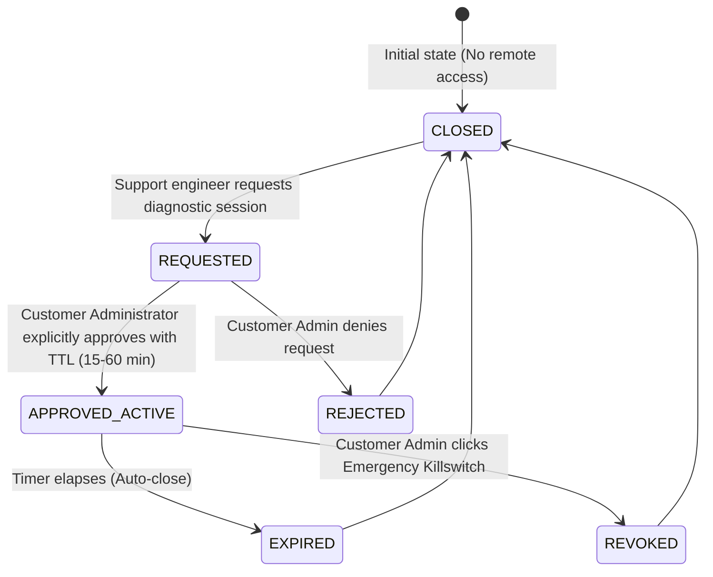
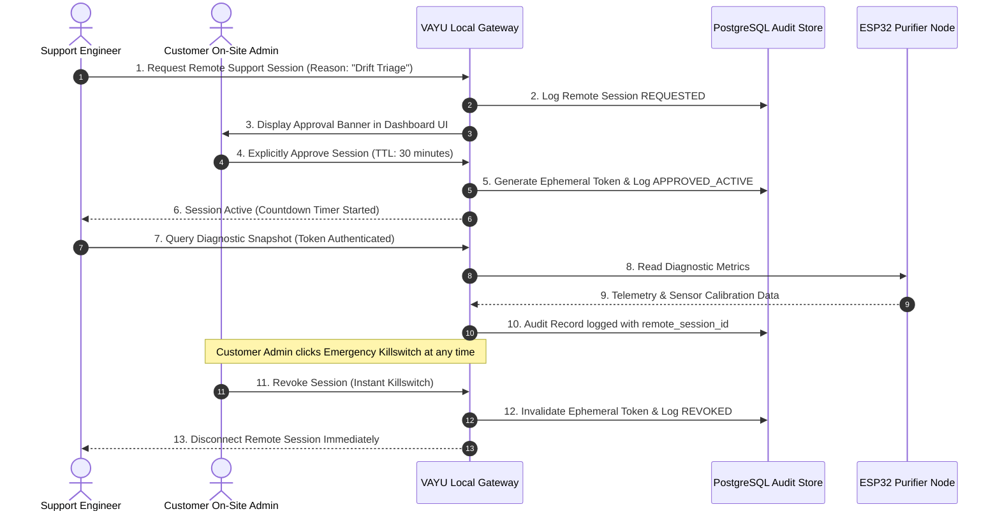

# ADR-006: Secure Remote Troubleshooting, Threat Model & Ephemeral Outbound Access Architecture

## Status
Accepted

## Context
When field service technicians or software engineers need to assist customers with complex firmware diagnostics, sensor drift triage, or connectivity faults, physical site visits may be impractical or slow. However, opening remote access to industrial IoT appliances presents substantial security and privacy risks.

### Non-Negotiable Project Constraints
1. **No External Cloud Hosting for Core Monitoring:** Core telemetry, health alerts, and database operations must remain strictly local-first.
2. **No Public Exposure of MQTT or PostgreSQL:** Ports `1883`, `9001`, and `5434` must never be exposed to public networks or bound to `0.0.0.0`.
3. **Firewall & NAT Realities:** Industrial customer gateways reside behind strict enterprise firewalls, CGNAT, or hospital VLANs that block all inbound ports.
4. **Customer Sovereignty & Explicit Consent:** Remote access must never be persistent, silent, or unannounced. Access must be granted on-demand by the customer's on-site administrator, bounded in time, and immediately revocable.
5. **Decoupled Local Safety:** The purifier's physical FreeRTOS safety controller must reject any remote command that attempts to bypass fan stall limits, thermal cutoffs, or EPA auto-speed curves.

---

## Threat Model (STRIDE Analysis)

| Threat Category | Potential Attack Vector | Impact on VAYU System | Architectural Mitigation Strategy |
| :--- | :--- | :--- | :--- |
| **Spoofing** | Attacker impersonates a SOCHI service engineer or customer admin. | Unauthorized command dispatch, fake firmware push, or setting changes. | Cryptographic JWT tokens with role-based claims (`ROLE_ADMIN`, `ROLE_DEV_ENGINEER`), signed consent challenges, and local administrator approval required. |
| **Tampering** | Man-in-the-middle (MITM) modifies diagnostic parameters or telemetry in transit. | False sensor readings or dangerous fan speeds injected. | Strict TLS 1.3 / mTLS transport encryption for all external channels; SHA-256 binary validation on firmware; EPA closed-loop safety controller running locally on ESP32. |
| **Repudiation** | Support technician executes an invasive diagnostic or configuration change and denies it. | Inability to establish root cause during customer dispute. | Immutable PostgreSQL `audit_logs` store capturing every remote session action with actor, timestamp, client IP, target device, and parameter payload. |
| **Information Disclosure** | Adversary intercepts air quality data to infer building occupancy or operational schedules. | Violation of enterprise data privacy and workplace surveillance concerns. | Zero cloud data egress by default. Remote sessions only relay specific diagnostic metrics requested during an active, approved session. |
| **Denial of Service** | Malicious actor floods local gateway or attempts to trigger continuous reboots. | Local monitoring dashboard disabled or purifiers knocked offline. | Gateway services run isolated in Docker with restart policies; rate limiting on API endpoints; ESP32 watchdog and autonomous failsafe operation ensure physical purifier continues filtering air even if gateway crashes. |
| **Elevation of Privilege** | Attacker uses compromised VAYU gateway to pivot laterally into customer's internal corporate network. | Compromise of adjacent enterprise servers, workstations, or medical equipment. | **No Layer-2/Layer-3 network bridging.** Remote access is constrained strictly to the VAYU application layer (HTTP/WebSocket reverse proxy to port 8081). The gateway never acts as an IP router or subnet VPN. |

---

## Architectural Decision: Outbound-Only Ephemeral Reverse Tunnel

We evaluate three remote access patterns:

### Option A: Inbound VPN / Port Forwarding (Rejected)
* Requires customer IT to open firewall ports or configure static NAT rules.
* Grants Layer 3 network routing into the customer's subnet, creating unacceptable lateral movement risks.
* **Verdict:** REJECTED (Violates enterprise security policies and project constraints).

### Option B: Permanent Mesh Overlay (Tailscale / ZeroTier) (Rejected)
* Requires continuous third-party cloud coordination infrastructure.
* Leaves a standing, 24/7 backdoor into the customer's gateway host.
* **Verdict:** REJECTED (Violates customer sovereignty and zero external cloud requirement).

### Option C: Outbound-Only Ephemeral Tunnel with Explicit Customer Consent (Selected)
* **Outbound-Only:** The local gateway initiates an outbound TLS connection (TCP port 443 outbound) to a designated secure support relay. No inbound ports are opened on the customer's firewall.
* **Explicit On-Site Consent:** A remote session can **only** be activated if the customer's local on-site administrator logs into `http://127.0.0.1:3000` and clicks **"Approve Remote Support Session"**.
* **Strict Time-to-Live (TTL):** Sessions automatically expire after a pre-set duration (default 30 minutes, maximum 60 minutes).
* **Emergency Killswitch:** The customer admin can click **"Revoke Session Immediately"** at any second, instantly closing the tunnel and invalidating all session tokens.
* **Zero Subnet Bridging:** The tunnel exposes only the local Spring Boot REST API for authenticated diagnostics; it never routes IP packets to other devices on the customer's LAN.

---

## Session Lifecycle & State Machine

---

## Consent & Access Sequence Diagram

---

## Consequences

### Positive
* **Zero Inbound Attack Surface:** Works through enterprise firewalls and NAT without port forwarding.
* **Customer Control:** Customer retains 100% control over when external personnel can connect.
* **Time-Bounded:** No forgotten standing access; access terminates deterministically.
* **Full Auditability:** Every action taken during remote support is cryptographically recorded in `audit_logs` with the associated `remote_session_id`.
* **Zero Network Bridging:** The support engineer cannot reach any other machine on the customer's network.

### Negative / Trade-offs
* Requires a customer representative to be present to click "Approve" when remote support is needed. (This is an intentional security design choice).
* Requires an outbound HTTPS relay endpoint when connecting between different physical sites.
