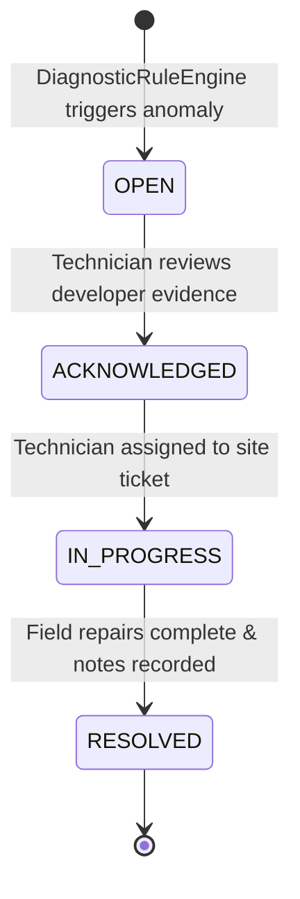

# SOCHI VAYU — Standard Operating Procedure 04: Incident Triage & Field Service Guide

**Document ID:** SOCHI-SOP-VAYU-004  
**Project:** SOCHI VAYU Industrial Air Quality Monitoring  
**Audience:** Field Service Technicians & Technical Support Specialists  
**Classification:** Internal Operating Procedure  

---

## 1. Purpose

This SOP guides field service technicians (`tech_pune`, `tech_blr`) in diagnosing, triaging, and resolving hardware faults, sensor corruptions, and operational anomalies reported by the SOCHI VAYU purifier fleet.

---

## 2. Hardware Fault Bitmask Reference

When a purifier encounters a hardware anomaly, the ESP32 safety controller sets bitwise flags in the `err_code` diagnostic metric. Corrupted sensor values emit literal `null` (never fabricated numbers):

| Bit | Hex Value | Diagnostic Meaning | Physical Cause | Immediate Hardware Safety Action | Field Remediation Checklist |
| :--- | :--- | :--- | :--- | :--- | :--- |
| **0** | `0x0001` | **Fan Stall / Tachometer 0 RPM** | Foreign object obstructing impeller; motor bearing seized; loose 4-pin tach wire. | Motor cut off within 5s by firmware interlock. Modes set to `ERROR_SAFE`. | 1. Isolate AC mains power. 2. Inspect intake impeller for foreign debris. 3. Inspect tachometer signal on GPIO 34. 4. Spin blade manually to verify bearing freedom. |
| **1** | `0x0002` | **PM Particulate Sensor Fault** | Plantower/Sensirion UART comms timeout; laser diode burnout; lens dust obscuration. | `pm1`, `pm25`, `pm10` emit literal `null`. AQI emits `null`. Safe 50% fan velocity. | 1. Inspect 8-pin UART ribbon connector. 2. Clean intake optical chamber with compressed air. 3. Verify 5V DC supply rail to sensor. 4. Replace PM module if UART timeout persists. |
| **2** | `0x0004` | **Temp / RH Sensor Fault** | SHT31 / BME280 I2C bus error; SDA/SCL pull-up open circuit. | `temp_c` and `rh` emit literal `null`. Environmental compensation disabled. | 1. Check I2C bus wiring (GPIO 21/22). 2. Verify 3.3V power bus. 3. Reseat sensor daughterboard. |
| **3** | `0x0008` | **Thermal Cutoff Protection** | Ambient air or motor driver heatsink $\ge 65^\circ\text{C}$ (warn) or $\ge 75^\circ\text{C}$ (trip). | Motor cut off immediately. Status indicates `OVERTEMP_TRIP`. | 1. Check cabinet exhaust ventilation. 2. Verify ambient room temperature. 3. Inspect PCB heatsink thermal paste. |
| **4** | `0x0010` | **Filter Lifespan Expired** | Filter operating hours left $\le 0$. | Amber status pill in UI; filter replacement warning displayed. | 1. Replace HEPA H13 / Activated Carbon filter cartridge. 2. Dispatch `FILTER_RESET` command via dashboard to reset timer to 4320 hours. |

---

## 3. Incident Lifecycle Workflow

Field technicians interact with incidents through the **Fleet Incident & Diagnostics Center** (`IncidentCenterModal.tsx`) on the dashboard:

### Step 3.1: Open Incident Center
1. Click the **Incidents** button in the dashboard header (highlighted with active incident count badge).
2. Service technicians will only see incidents for their assigned site (`SITE-HQ-PUNE` or `SITE-BLR-DEV`).

### Step 3.2: Inspect Developer Evidence Snapshot
1. Click on the active incident row.
2. Review the cryptographic **Developer Evidence JSON Snapshot**:
   * Snapshot metrics at trigger time (PM2.5, VOC, fan speed, err code).
   * Rolling 5-frame telemetry window prior to incident creation.
   * Specific diagnostic checklist customized for the detected fault.

### Step 3.3: Acknowledge & Assign Incident
1. Click **Acknowledge Incident** to indicate triage has begun.
2. Select your technician name and click **Assign to Me**.
3. All status changes generate cryptographic audit trail entries in PostgreSQL (`AUDIT_LOG`).

### Step 3.4: Complete Repairs & Record Resolution
1. Perform physical inspection and hardware replacement following the Field Remediation Checklist above.
2. Return to the Incident Center, enter detailed **Resolution Notes** (e.g., *"Cleared debris from impeller; tachometer reads nominal 1850 RPM; AQI 24 nominal"*).
3. Click **Resolve Incident**.
4. The incident closes, and the header incident badge decrements.
