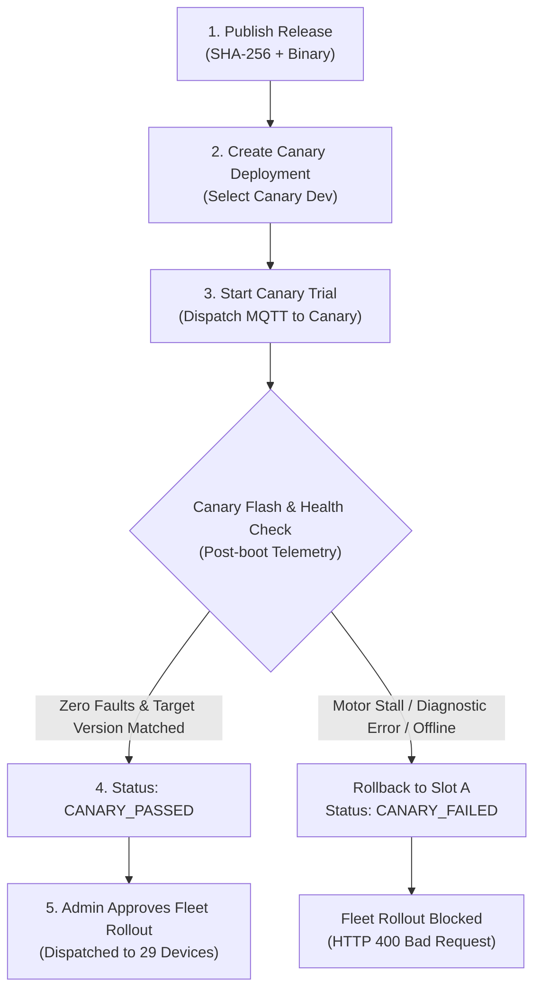

# SOCHI VAYU — Standard Operating Procedure 05: Safe OTA Release & Canary Rollout Protocol

**Document ID:** SOCHI-SOP-VAYU-005  
**Project:** SOCHI VAYU Industrial Air Quality Monitoring  
**Audience:** Firmware Engineers & Software Operations  
**Classification:** Internal Operating Procedure  

---

## 1. Safety Principles & Non-Negotiable Rules

> [!IMPORTANT]
> Firmware updates on industrial air purifiers carry safety-critical implications (fan control, motor stall protection, thermal cutoffs). Under no circumstances shall an unverified firmware binary be pushed directly to customer fleets.

### Mandated Safety Rules:
1. **Two-Partition A/B Layout:** Every node must maintain two active application partitions (`ota_0` and `ota_1`). Updates are written only to the passive partition.
2. **Cryptographic Integrity:** Every release must be indexed with its 64-character SHA-256 checksum digest. The node validates the hash prior to switching the active boot partition.
3. **Mandatory Canary Trial:** Fleet-wide deployment is **strictly locked** in software until at least one dedicated canary device (`VAYU-DEV-001`) boots the image and proves nominal operation without error codes.
4. **Autonomous Rollback on Fault:** If the canary device crashes, boot-loops, drops offline, or emits diagnostic error flags (`err_code > 0`) during post-flash trial, the system marks the deployment `CANARY_FAILED` and **locks fleet rollout with HTTP 400 Bad Request**.

---

## 2. Firmware Partition Layout (`partitions_two_ota.csv`)

```text
# Espressif ESP32 4MB Dual-OTA Partition Table
# Name,   Type, SubType, Offset,   Size,     Flags
nvs,      data, nvs,     0x9000,   0x4000,
otadata,  data, ota,     0xd000,   0x2000,
phy_init, data, phy,     0xf000,   0x1000,
factory,  app,  factory, 0x10000,  0x100000,
ota_0,    app,  ota_0,   0x110000, 0x100000,
ota_1,    app,  ota_1,   0x210000, 0x100000,
storage,  data, spiffs,  0x310000, 0xF0000,
```

---

## 3. Step-by-Step Canary Rollout Procedure



### Step 3.1: Publish Firmware Release to Catalog
1. Compile the firmware binary and calculate its SHA-256 digest:
   ```bash
   sha256sum build/vayu-esp32-node.bin
   ```
2. Navigate to the **OTA & Firmware Center** on the dashboard (`http://127.0.0.1:3000`) and select the **Firmware Catalog** tab.
3. Click **+ Publish New Release**, enter the version (e.g., `v1.2.0-prod`), Build ID, SHA-256 digest, binary path, and release notes. Click **Publish Release**.

### Step 3.2: Create Canary Deployment
1. Under the **Active Deployments** tab, click **+ New Canary Deployment**.
2. Select target version: `v1.2.0-prod`.
3. Set Strategy: `CANARY`.
4. Designate Canary Device: `VAYU-DEV-001` (Cleanroom reference device).
5. Set Trial Duration: `60 seconds`.
6. Click **Create Deployment**. The deployment enters `CREATED` state.

### Step 3.3: Initiate Canary Trial
1. On the deployment card, click **⚡ Start Canary Trial (VAYU-DEV-001)**.
2. The orchestrator dispatches an `OTA_UPDATE` command via MQTT topic `vayu/VAYU-DEV-001/cmd`.
3. The canary device downloads the binary into passive partition slot B, verifies the SHA-256 checksum, sets `esp_ota_set_boot_partition()`, and reboots into slot B.
4. Status transitions to `CANARY_ACTIVE`.

### Step 3.4: Evaluate Post-Flash Health
1. After the canary boots, allow 15–30 seconds of telemetry frames to ingest.
2. Click **🔍 Evaluate Canary Telemetry Health**.
3. The backend inspects ingested telemetry:
   * **Pass Condition:** Device `onlineStatus == ONLINE`, `currentFwVersion == "v1.2.0-prod"`, and `err_code == 0`. Status advances to `CANARY_PASSED`.
   * **Fail Condition:** Device reports `err_code != 0`, fails to boot slot B, or drops offline. Status transitions to `CANARY_FAILED`.

### Step 3.5: Approve Fleet-Wide Rollout
1. Once `CANARY_PASSED` is confirmed, the **🚀 Approve & Broadcast Fleet Rollout** button unlocks.
2. An Administrator clicks **Approve & Broadcast Fleet Rollout**.
3. The orchestrator broadcasts `OTA_UPDATE` commands to all remaining 29 fleet devices across Pune and Bangalore sites.
4. Deployment status transitions to `FULL_ROLLOUT`.

---

## 4. Rollback Post-Mortem & Incident Investigation

If a deployment transitions to `CANARY_FAILED`:
1. The safety interlock will **prevent** any technician or admin from rolling out the bad image to the fleet.
2. Open the **Device History & Rollback Logs** tab in the OTA modal.
3. Inspect `VAYU-DEV-001` OTA history to determine the failure cause (e.g., *Checksum mismatch*, *Motor stall error code 0x0001*, or *Watchdog reset loop*).
4. Verify that the canary node safely reverted to its baseline partition slot A.
5. In PostgreSQL, mark the release `status = 'REVOKED'`:
   ```sql
   UPDATE firmware_releases SET status = 'REVOKED' WHERE version = 'v1.2.0-prod';
   ```
6. Return to firmware development and resolve the defect before re-issuing a new release candidate.
